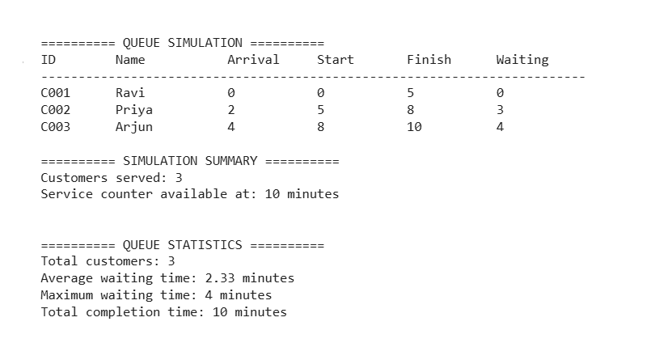

# QueueFair - A Service Center Queue Simulation Engine

## About the Project

QueueFair is a menu-driven Python application that simulates a customer queue at a service center. It processes customers based on their arrival times and calculates service start times, finish times, and waiting times.

This project was developed to practice core Python concepts through a practical, real-world-inspired problem.

## Features

- Add customers with automatically generated customer IDs.
- Validate customer names, arrival times, and service durations.
- View registered customers in a formatted table.
- Simulate a single service counter.
- Calculate customer waiting times, service start times, and finish times.
- Display queue statistics, including average and maximum waiting times.
- Export simulation results to a CSV file.
- Navigate all features through a menu-driven interface.

## Technologies Used

- Python 3
- Built-in `csv` module

## Python Concepts Practiced

- Variables and data types
- Lists and dictionaries
- Conditional statements and loops
- Input validation using `try-except`
- Sorting using `sorted()` and lambda expressions
- Built-in functions such as `sum()` and `max()`
- F-strings and formatted output
- File handling and CSV export

## How to Run

1. Download `queuefair.py` from this repository.
2. Make sure Python 3 is installed on your computer.
3. Open a terminal in the folder containing the file.
4. Run:

   `python queuefair.py`

5. Choose an option from the displayed menu.

## Simulation Logic

QueueFair sorts customers by arrival time and processes them using one service counter.

- **Start time:** The later of the customer's arrival time and the counter's available time.
- **Finish time:** Start time plus service duration.
- **Waiting time:** Start time minus arrival time.

## Output

The application displays customer details, simulation results, and summary statistics. It can also export the simulation results to `queuefair_results.csv`.

## Project Scope

This version uses a single service counter. Customer information is stored in memory while the program is running.

## Author

Developed as a Python project to practice programming fundamentals and problem-solving.

## Sample Output

